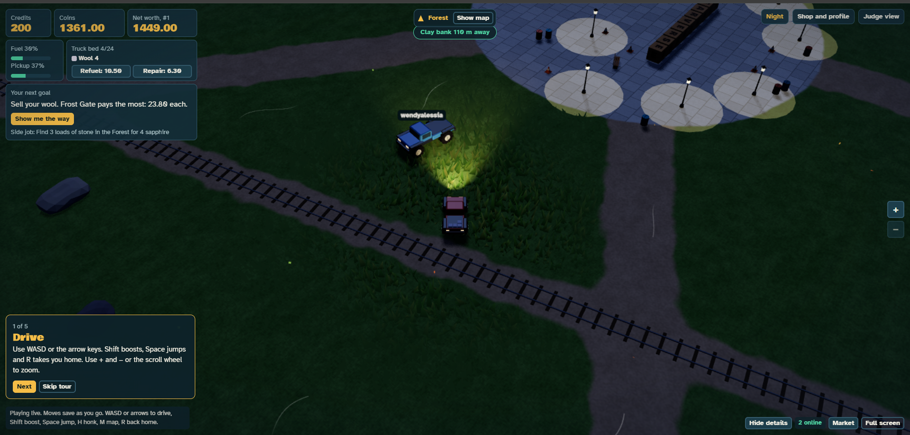
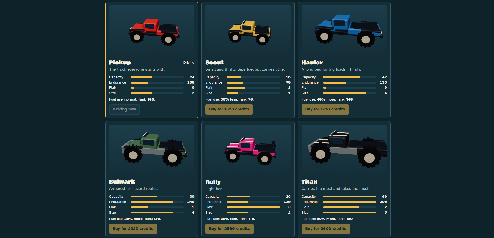
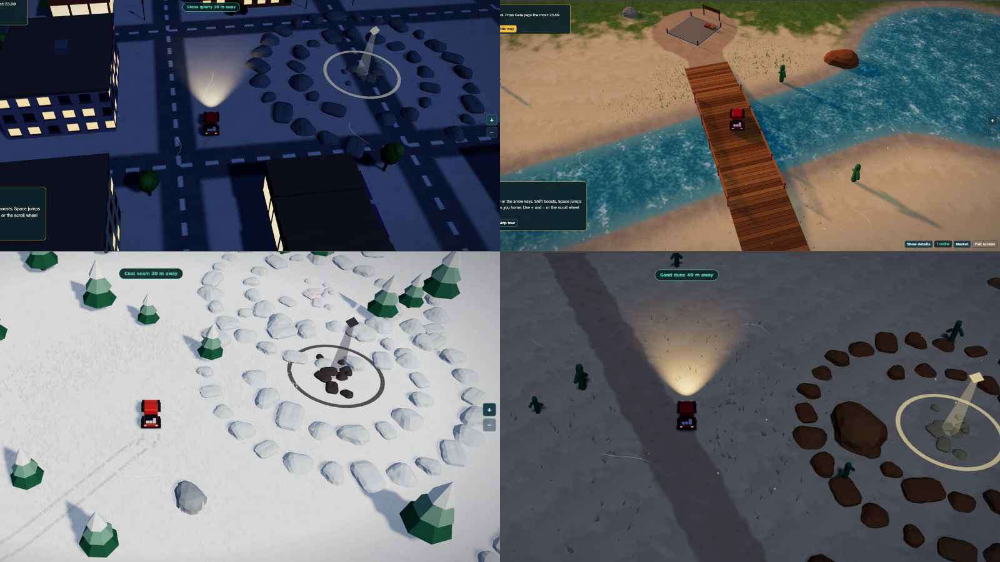
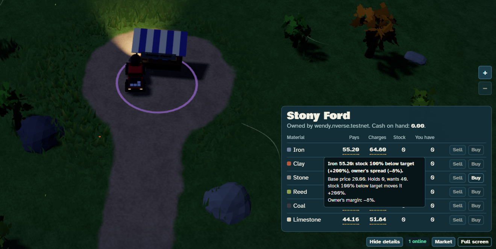

# Nearverse



A drivable 3D treasure hunt with a real, player-run economy, built for the NEAR Hackathon `games` track.

**Play it:** https://nearverse-murex.vercel.app  
**Contract (NEAR testnet):** [`nearverse-game-v3.testnet`](https://testnet.nearblocks.io/address/nearverse-game-v3.testnet). Every trade is visible on the explorer.

## Try it in 3 minutes


*On a phone: steer with the stick and press Gas to drive. Turn the phone sideways for the best view.*

1. Open https://nearverse-murex.vercel.app and sign in with Google or an email code, or press **Play as a guest**.
2. Press **Point me to one** in the tip at the bottom of the screen (on a phone, tap **? Tip** first) and follow the arrow to a resource.
3. Hold **E** to load it, then drive to the merchant the goal suggests and sell.
4. Tap the price before and after selling. It drops, and the tooltip explains why.
5. Open https://nearverse-murex.vercel.app/judge and press **Run a week** to watch a week of the market in seconds.

## The problem

Most crypto games make people learn about wallets, seed phrases and gas before they can play, and many never get past that. Often the game is also just a token with some gameplay attached.

Nearverse puts the game first. Sign in with Google or email and start driving. After that, moves are signed in the background with no wallet pop-ups, while the market and what you own live in a contract anyone can read.

## The game

- **Hunt.** Drive across an island of forest, snowfields, desert and city, through day and night. Resources aren't on the map, but when you get within 150 metres of any resource, rare ones included, a notice tells you what it is and counts down the distance as you close in, for example "Resin grove 30 m away". The rarest are guarded by bombs or sit in rock-ringed pools, and driving through water is slow and burns fuel three times as fast.
- **Trade.** Sell to merchants and player stalls. Every trade changes the price, so finding the best deal is part of the game.
- **Side jobs.** Every 2 hours a new side job marks one resource spot. Load from it 3 times before it changes and the contract adds 4 of a reward material, which changes with each job and can be a rare one, to your truck for free. **Show me the spot** points the arrow there.
- **Upkeep.** Coins pay for fuel and repairs, so each load funds the next trip.
- **Damage and wear.** Hitting trees, rocks, buildings or a bomb costs your vehicle health, and every load wears it down too. A damaged vehicle slows down and starts smoking until you repair it, and an empty tank leaves you crawling.
- **Build.** Buy a plot with credits, bring its materials over as many trips as you like, and open a stall that earns coins for you.
- **Invest.** Put coins into a merchant, reopen it if it has closed, and earn a share of what it sells.
- **A big world.** 24 materials, 5 merchants and 30 plots across the island described below.
- **Merchants can go bust.** A merchant that runs out of cash closes completely. Only players investing coins can reopen it.
- **Ghost traders.** Labeled simulated players with their own NEAR wallets that trade for real, built to keep the market moving when few people are online. They run on an always-on machine, so they aren't active on the hosted demo. With a NEAR AI key, each one asks a NEAR AI Cloud model which move to make next and why. Without one, or if the model fails, it falls back to fixed rules.
- **Together.** Drivers see each other on the island in real time, with each car showing its player's name.

## Vehicles



Everyone starts with the Pickup for free. Credits buy the others, and each trades cargo space, toughness and fuel use differently. The contract works out every price from the vehicle's stats.

| Vehicle | Price (credits) | Cargo | Health | Fuel use | Good for |
| --- | --- | --- | --- | --- | --- |
| Pickup | Free | 24 | 100 | Normal | Starting out |
| Scout | 1,620 | 16 | 90 | Half | Long, cheap trips with small loads |
| Hauler | 1,780 | 42 | 130 | 1.4× | Big loads |
| Bulwark | 2,320 | 30 | 240 | 1.2× | Bomb-guarded spots and rough routes |
| Rally | 2,560 | 26 | 120 | 0.7× | Fuel-saving trips with a light bar and racing paint |
| Titan | 3,600 | 60 | 300 | 1.5× | Carrying the most and taking the most hits |

## The world



One island, about two kilometres across, with no loading screens between areas.

- **Forest and meadow** cover the middle of the island, with trees, rocks and dirt tracks between them.
- **Snowfields** at one end of the island turn the ground and roads white.
- **Desert** on the far side is sand, dunes and open ground.
- **The city** has streets, buildings and its own hum. Merchants and player stalls sit along its roads.
- **Rivers and lakes** cut across the island: 8 rivers and 3 lakes. 5 bridges cross the rivers, or you can drive through the water, slowly, with fuel burning three times as fast.
- **Rare pools** are 9 small pools ringed by rocks, each hiding a rare material.
- **A railway** runs across the island, with stations along the line.
- **Fuel stations** stand at 5 points around the island.
- **Day and night** follow one shared clock, so every player sees the same sky. A full day takes eight minutes. At night, street lamps light up the city and the island goes dark and blue.
- **Sound** changes with where you are: running water near rivers, wind in the open, and the hum of the city.

## What NEAR does here

**Every action is a transaction.** Loading a resource, selling, buying, refuelling, repairing, every crash, the fuel you burn while driving, building and investing are all calls to the contract, signed and sent in the background. Players never see a wallet prompt, but every action is on-chain and visible on the explorer.

**Named accounts.** A Google or email login creates a readable account, such as `alice.nverse.testnet`, under the game's parent account. There's no seed phrase to manage.

**Function-call access keys.** The browser holds a key that can only call the game contract, with a capped gas allowance. It can't attach NEAR, so it can't buy credits or transfer items. That's why moves need no pop-ups, while `buy_credits`, `withdraw_revenue` and `mt_transfer` still need a full signature.

**One NEP-245 contract.** All 24 materials, from wood to meteorite, are balances in one multi-token contract. Gathering mints and selling burns. The standard `mt_*` transfer and view methods are present, but approvals aren't implemented.

**The economy runs in the contract.** It sets prices from merchant stock and holds coins and credits, plot ownership, stall building progress and investor shares. Prices move on the chain rather than on a game server, and a trade fails with `PRICE_MOVED` instead of filling at a surprise price.

**Low gas.** A move costs about 11.5 Tgas (roughly 0.00115 NEAR), measured on testnet. That's cheap enough for every trade to settle on-chain, with the game topping up players' gas automatically.

**Your progress follows you.** Materials, coins, credits, fuel and truck condition are stored under your account in the contract. Sign in on another phone or computer and the game reads them back, so you carry on with the same load.

**NEAR AI for ghost traders.** Ghost traders can use NEAR AI Cloud to choose their moves. The model only picks from moves the game allows and gives a short reason; the contract still enforces every price and rule, so no AI can change the market directly. This is a prototype: it has been tested against a stub server, with the rule-based fallback always on.

| Setting | Default if not set |
| --- | --- |
| `NEAR_AI_API_KEY` | None. Without it, ghost traders use fixed rules |
| `NEAR_AI_URL` | `https://cloud-api.near.ai/v1/chat/completions` |
| `NEAR_AI_MODEL` | `openai/gpt-5-nano` |
| `NEAR_AI_DAILY_CALLS` | `6000`. After that, traders use fixed rules until the next day |

Set these where the ghost traders run, not on the website host.

**Revenue.** `buy_credits` takes NEAR at 1 NEAR = 1000 credits, and only the owner can withdraw it. Credits buy vehicles and plots.

## How prices work



Rules live in one file, `config/merchants.rules.yaml`. The contract enforces them, and the tooltips run the same formula from the same state.

`price = base × (target stock ÷ current stock)^k`, held between 35% and 300% of base.

1. Selling raises a merchant's stock, so its price falls for the next seller. Buying does the opposite.
2. Each market hour (10 real minutes), stock drifts back toward target, and elapsed time is applied on each contract call.
3. Stock left too high or too low for a market day moves the target itself, within 60–160% of the original.
4. Market events cut or swell a material's stock at every merchant.
5. Rare materials move most. Merchants hold few of them, so one sale is a large share of their target.

**Example.** Iron has a base of 20.00, and the Hoarder wants 160 with `k` = 0.5:

| Hoarder's iron stock | Price | Pays you (10% margin) | Charges you (10% margin) |
| --- | --- | --- | --- |
| 120 (short) | 23.09 | 20.78 | 25.40 |
| 160 (on target) | 20.00 | 18.00 | 22.00 |
| 320 (flooded) | 14.14 | 12.73 | 15.56 |

**Prices explain themselves.** Tap any price in the game to see why it is that price: stock, target, events and margin, worked out with the same formula as the contract.

Price also moves with each unit in a sale, so selling 24 at once earns less than 24 times the first price. Merchants always charge more than they pay, so buying and selling straight back loses money.

## Try it

**Hosted**

1. Open https://nearverse-murex.vercel.app/signin, sign in with Google or an email code, and choose a username. Or press **Play as a guest**.
2. Drive with WASD or arrows, or the on-screen stick and Gas on a phone. When a prompt says you've found a resource, hold **E** to load it.
3. Drive to a merchant and sell. Hover or tap a price to see why it's that price.
4. Open https://nearverse-murex.vercel.app/judge, press **Run a week**, then **Flood the market with iron**, and watch the price fall. This fast-forward is a labeled simulation in the browser and sends no transactions.

**Locally, with no chain**

Docker Engine with Compose 2.24 or newer is the only requirement.

```bash
docker compose up --build
```

Open http://localhost:3000 for the game in practice mode, or http://localhost:3000/judge for the market view. Use `WEB_PORT=8080` if port 3000 is taken.

| Command | What it does |
| --- | --- |
| `docker compose run --build --rm test` | Type checks, economy tests, contract tests and the compiled-contract check |
| `docker compose run --build --rm e2e` | Plays the game in a real browser |
| `docker build --target contract-wasm --output out .` | Writes the contract to `out/nearverse.wasm` |
| `docker compose run --build --rm deploy` | Builds and deploys the contract to testnet |
| `docker compose run --build --rm smoke` | Runs the game loop against the deployed contract |
| `docker compose --profile ops up -d --build ghosts tracker` | Runs labeled simulated traders and the price tracker on an always-on machine |

To run your own testnet copy, see [DEPLOY.md](DEPLOY.md). Variable names are in `.env.example`.

## What has been tested

| Part | Status |
| --- | --- |
| Economy rules | 2,500 replayed steps match exactly between TypeScript and Rust |
| Contract | Unit tests, plus the compiled wasm against mocked host functions |
| Web game | Browser tests in practice mode |
| Deployed contract | Game loop run on testnet with the smoke test |
| Google sign-in | Run on the hosted site |
| Email codes | Run on the hosted site |
| Buying credits | Run on the hosted site |
| Key export through this login | Tested with simulated responses |
| Other drivers in real time over Ably | Run on the hosted site with two players |
| AI choosing ghost traders' moves | Fallbacks tested against a stub server, not run against NEAR AI |
| Phones | Touch stick and Gas pedal, landscape mode, folding help tips. Frame rate not measured; detail drops automatically to hold it |

## Known limits

- **Testnet only.** Credits and coins can't be withdrawn.
- **The contract can't verify driving.** Location, crash damage and driving fuel are reported by the browser, so a modified client or script could skip the drive. On-chain limits still apply: spot stock, a gather cooldown, fuel, wear and cargo space. Resource positions can also be read from this open-source repo.
- **Google and email sign-in hold key power on the server.** The server derives each player's key from one secret and their verified email, and stores none of them. Anyone with that secret could control these wallets, so this suits testnet only. Mainnet would need NEAR Auth production credentials.
- **Players don't pay their own gas yet.** The game funds accounts from a treasury, and the contract pays player storage, so mass sign-ups could drain them. A relayer is planned for mainnet.
- **Griefing.** Each merchant takes at most 10 investors, and small stakes could fill those slots. Investing is permanent. The game has no way to send items, but the contract follows the NEP-245 standard, so anyone could send you items directly with a wallet, filling your truck bed until you sell them.
- **Inflation.** Rich-spot bonuses and merchants' hourly income create coins, which would need attention before real value.
- **Browser-only data.** Your discovery log and the sales marked on your chart stay in your browser, so another device starts fresh.
- **Guest play** keeps a throwaway full-access key in the browser for a faucet-funded testnet account.
- **Other cars are visual only.** Their positions travel over Ably and never touch the contract, and you drive through them.
- **Ghost traders** are labeled simulated players with real wallets and real trades. They need an always-on machine, so they aren't always running. No AI model can change a price.

## What's next

- **Player-run pricing through a Sputnik DAO.** Hand the NEAR-to-credits rate and vehicle pricing to a DAO, so players vote on what it costs to join and what credits buy. A passed vote would call the contract directly, with limits on how far a price can move at once and a delay shown in the game before it takes effect.
- **A shared treasury.** Send revenue from credit purchases to the same DAO, so players decide how it's spent, for example on gas for new players or prizes for top traders.
- **Mainnet.** A relayer to pay players' gas, and NEAR Auth production credentials for sign-in, so no single server secret holds key power.

## Layout

| Path | Contents |
| --- | --- |
| `config/` | Items and pricing rules |
| `contracts/nearverse/` | Rust contract |
| `packages/economy/` | Rules, simulation and tooltips in TypeScript |
| `web/` | Next.js app (`/`, `/play`, `/signin`, `/judge`, `/profile`, `/status`) |
| `scripts/` | Generation, deploy, smoke tests, ghost traders, price tracker |
| `tests/e2e/` | Browser tests |

## Third-party code and AI disclosure

Written during the hackathon window, with no template. Libraries: near-sdk, near-kit, near-api-js, NEAR Auth SDK (`@fast-auth-near/*`), Next.js, React, three.js, react-three-fiber, react-three-rapier, Rapier, zustand, Ably, Google Identity Services, NEAR AI Cloud (optional), yaml, vitest, Playwright, binaryen and fontsource (Bowlby One, Atkinson Hyperlegible).

Nearverse was designed and directed by me: the idea, the game design, the economy, every feature decision and all testing on the live site. Much of the code was written with Claude, an AI coding assistant, working from my direction and reviewed by me. No code or assets were copied from other projects.

License: MIT.
